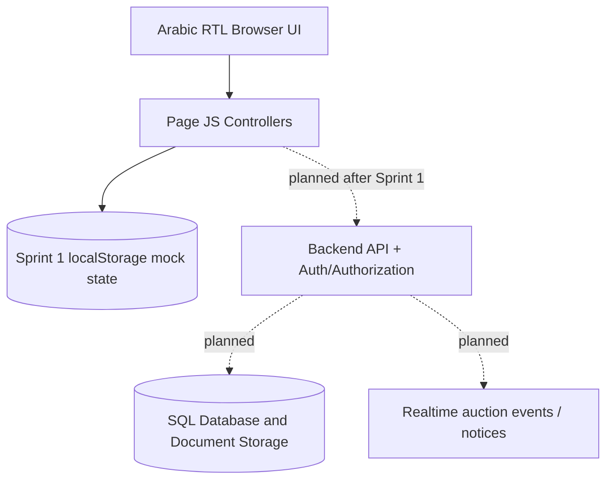
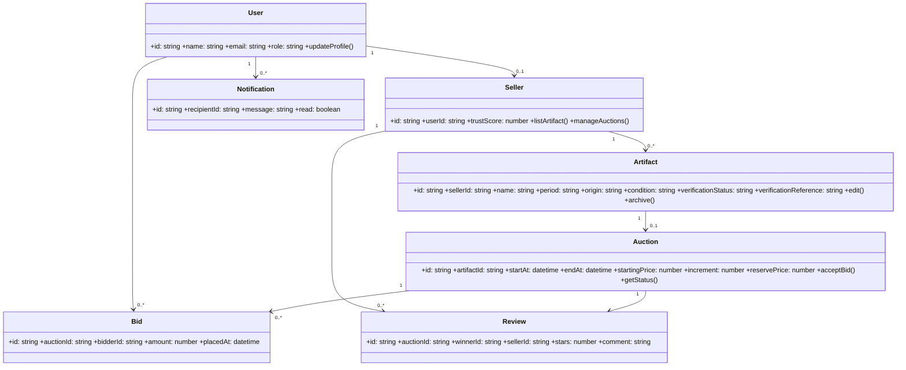
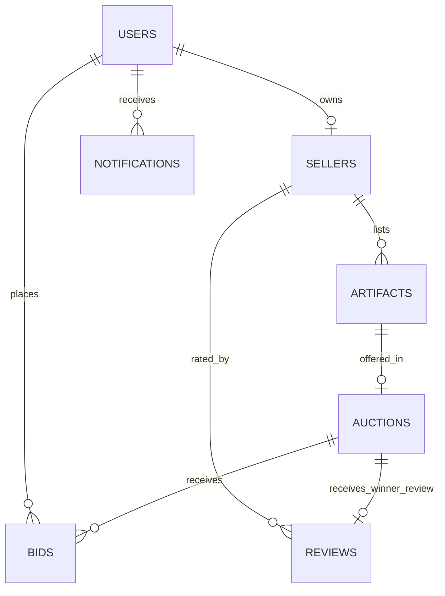
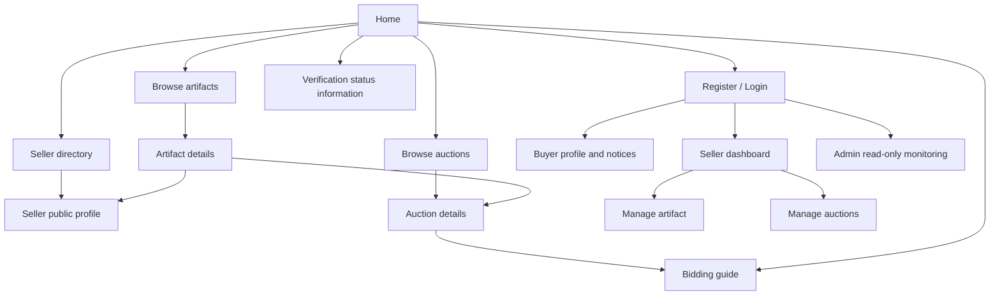

# Chapter 4 — Sprint 1 preliminary system design notes

These **reference notes** are intended to help the team prepare Chapter 4 of its required course PDF. They are not a replacement for the report, its instructor feedback, or verified GitHub/Jira links. Diagrams describe the **target system** where stated; at Sprint 1, the database and authentication server are intentionally not connected.

## 4.1 System Architecture

For Sprint 1 the system is a responsive frontend with a single JS module and mock browser-local repositories. A future three-tier architecture can be used later for secure, cross-user auctions.



- Presentation: page templates, CSS, motion/accessibility, search/filter, forms.
- Domain logic in prototype: bid validation, winner calculation, Trust Score, ranking.
- Data demo repository: accounts, seller profiles, artifacts, auctions, bids, reviews, notifications stored under `alfaw_phase3_*` in browser storage.
- Future backend boundary: persistent repositories, transactions, user sessions, authority-supplied verification status. **Not implemented in Sprint 1.**

## 4.2 Class Diagram (conceptual final system)



## 4.3 SQL relational schema — planned design, not implemented



Planned schema (no current SQL database):

- `users(id PK, email UNIQUE, password_hash, name, role, city, created_at)`
- `sellers(id PK, user_id FK, public_name, bio, city)`
- `artifacts(id PK, seller_id FK, name, description, period, origin, condition, category, verification_status, verification_reference, archived)`
- `artifact_documents(id PK, artifact_id FK, filename, content_type, storage_key)`
- `auctions(id PK, artifact_id FK UNIQUE, start_at, end_at, starting_price, min_increment, reserve_price)`
- `bids(id PK, auction_id FK, bidder_id FK, amount, created_at)`
- `reviews(id PK, auction_id FK UNIQUE, buyer_id FK, seller_id FK, stars, comment, created_at)`
- `notifications(id PK, recipient_id FK, auction_id FK NULL, message, created_at, is_read)`

Selected data dictionary terms: `verification_status` (verified or unverified status **from an external authority**, not issued by AlFaw); `min_increment` (minimum mandatory increase); `reserve_price` (seller-defined minimum price required for winner); `stars` (integer 1–5, only once by the auction winner); `role` (buyer, seller, administrator). Backend enforcement is **future work**.

## 4.4 Component Design (three business-critical components)

### A. Validate and record bid

```text
function placeBid(user, auction, bidAmount):
    if user.role != Buyer: reject
    if auction.status != Active or now >= auction.endAt: reject
    if auction.sellerId == user.sellerId: reject
    highest = lastAcceptedBid(auction) or auction.startingPrice
    required = highest + auction.minIncrement
    if amount is not finite or amount < required: reject
    atomically record bid and broadcast updated highest/history/ranking
```

### B. Calculate bidder ranking

```text
function ranking(auctionBids):
    bestPerBidder = map bidderId -> highest valid bid
    for bid in auctionBids:
        bestPerBidder[bid.bidderId] = max(previous, bid.amount)
    return sort(bestPerBidder descending by amount)
```

### C. Compute seller Trust Score

```text
function trustScore(sellerReviews):
    eligible = reviews written by verified winners once per auction
    if eligible is empty: return "No ratings yet"
    average = sum(each rating.stars) / eligible.count
    return round((average / 5) * 100) percent
```

The three processes are future server-enforced business functions. Sprint 1 implements visible mock workflows only; concurrency and cross-user synchronization cannot be established by a local frontend.

## 4.5 Site map



**GitHub:** team to insert actual project URL in its report after uploading all source files, `README.md`, and `AUTHORS`.

**Jira:** team to insert its real Jira URL in the report and invite the lab instructor; a ZIP cannot perform this external action.
